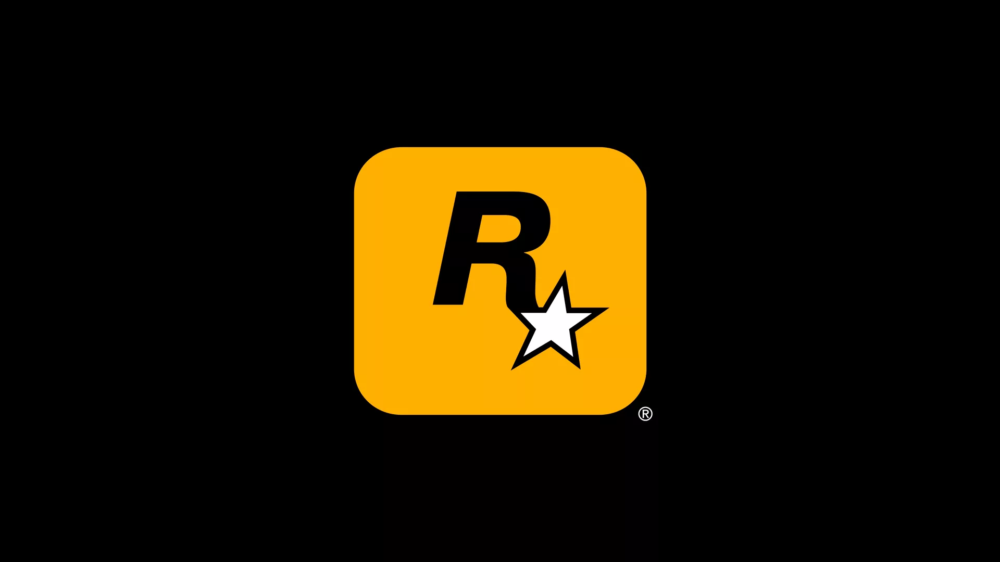

# Case Study 001: Rockstar Games

  

## 02 Business Needs, Problems & Objectives

**Project:** Project BA — 1-Year Quest to Analyze 100 Business Processes  
**Company:** Rockstar Games  
**Industry:** Video Game Development & Publishing  
**Parent Company:** Take-Two Interactive  
**Analysis Stage:** Business Needs, Problems & Objectives

---

## 1. Overview

This case study explores Rockstar Games' business context, potential business needs, problems, objectives, opportunities, and desired outcomes.

The purpose is to understand what the organization needs to achieve, identify potential challenges, and establish a foundation for further Business Analysis activities.

**Scope:** This analysis is based on publicly available information. Potential problems and root causes are hypotheses, not confirmed internal business issues.

## 2. Business Context

Rockstar Games is a video game developer and publisher owned by Take-Two Interactive. It develops premium games such as Grand Theft Auto and Red Dead Redemption, generating revenue through game sales, online services, subscriptions, and in-game purchases.

Rockstar operates in a competitive gaming industry where player expectations, technological advancements, development costs, and long-term engagement influence its success.

## 3. Business Needs

| # | Business Need | Why It Matters |
|---|---|---|
| 1 | Sustain Player Engagement | Maintains player communities and the long-term value of its games. |
| 2 | Deliver Successful Major Releases | Protects its reputation and generates significant revenue. |
| 3 | Strengthen Recurring Revenue | Creates revenue beyond initial game purchases. |
| 4 | Maintain Product Quality and Innovation | Differentiates Rockstar from competitors. |
| 5 | Ensure Sustainable Game Operations | Supports efficient development and reliable online services. |

**Summary:** Rockstar needs to deliver successful games, maintain long-term player engagement, generate recurring revenue, protect product quality, and sustain its gaming ecosystem.

## 4. Potential Business Problems

| # | Potential Business Problem | Potential Business Impact |
|---|---|---|
| 1 | High dependence on major game releases and franchises. | Revenue may be affected by delays or unsuccessful releases. |
| 2 | Maintaining player engagement throughout long game lifecycles. | Declining engagement may reduce recurring revenue. |
| 3 | Increasing game development complexity and costs. | May increase financial risk and development timelines. |
| 4 | Maintaining a stable and fair online gaming environment. | Cheating, disruptions, or security incidents may affect player satisfaction. |
| 5 | Managing player migration between major releases and existing games. | May affect engagement and revenue from existing online services. |

**Summary:** Rockstar may face challenges maintaining sustainable revenue and player engagement while managing high development costs, franchise dependence, and online gaming operations.

## 5. Business Objectives

| # | Business Objective | Desired Direction |
|---|---|---|
| 1 | Increase Player Engagement | Maintain active and returning players. |
| 2 | Maximize Major Game Success | Achieve strong sales and positive player reception. |
| 3 | Grow Recurring Revenue | Increase revenue from online services and in-game spending. |
| 4 | Maintain Competitive Advantage | Deliver innovative and high-quality gaming experiences. |
| 5 | Improve Operational Sustainability | Maintain efficient, reliable, and sustainable game operations. |

**Summary:** Rockstar aims to maintain player engagement, maximize game success, grow recurring revenue, preserve its competitive advantage, and sustain efficient operations.

## 6. Business Opportunities

| # | Business Opportunity | Potential Value |
|---|---|---|
| 1 | Improve Player Feedback and Data Analysis | Better understand player behavior and preferences. |
| 2 | Strengthen Online Gaming Ecosystems | Increase player retention and game longevity. |
| 3 | Expand Recurring Revenue Opportunities | Generate more predictable long-term revenue. |
| 4 | Support User-Generated Content and Creators | Encourage community participation and engagement. |
| 5 | Improve Development Efficiency | Reduce inefficiencies while maintaining quality. |

**Summary:** Rockstar may create additional value through improved player insights, stronger online ecosystems, recurring revenue models, creator communities, and more efficient development processes.

## 7. Desired Business Outcomes

| # | Desired Business Outcome | Potential Measurement |
|---|---|---|
| 1 | Higher Player Retention | Player retention rate, returning players |
| 2 | Increased Recurring Revenue | In-game spending, subscription revenue |
| 3 | Successful Game Releases | Sales, revenue, player ratings |
| 4 | Improved Online Experience | Server uptime, player complaints |
| 5 | More Efficient Development | Development time, costs, milestone completion |

**Summary:** Successful business changes may result in stronger player engagement, sustainable revenue, successful game releases, improved online experiences, and more efficient operations.

## 8. Key Findings

| Category | Finding |
|---|---|
| Most Important Business Need | Sustain long-term player engagement and revenue across Rockstar's gaming ecosystem. |
| Most Important Potential Problem | High dependence on major game releases and franchises may expose the business to revenue fluctuations. |
| Most Important Business Objective | Maintain player engagement while maximizing the commercial success and long-term value of its games. |
| Most Promising Opportunity | Improve player engagement through better understanding of player behavior, feedback, and content preferences. |
| Potential Desired Outcome | Maintain strong player engagement, generate sustainable revenue, and operate the gaming ecosystem efficiently. |

## 9. Assumptions & Limitations

**Assumptions**

- Player engagement contributes to the long-term value of Rockstar's games.
- Recurring revenue is important to its business model.
- Major game releases represent significant business events.

**Limitations**

- Analysis is based on publicly available information.
- Internal processes and performance data are unavailable.
- Identified problems and root causes are hypotheses, not confirmed issues.

## 10. Conclusion

Rockstar Games needs to maintain player engagement, deliver successful major releases, generate recurring revenue, and sustain its competitive advantage.

Potential challenges include dependence on major franchises, maintaining long-term engagement, increasing development complexity, and managing online gaming operations.

Further Business Analysis is required to validate these potential problems and identify the business processes that may contribute to them.

---

## References

1. [Take-Two Interactive — SEC Filings](https://www.sec.gov/edgar/browse/?CIK=946581&owner=exclude) — Business risks, competition, product development, and franchise dependence.
2. [Take-Two Interactive — Investor Relations](https://ir.take2games.com/) — Financial performance and business strategy.
3. [Rockstar Games](https://www.rockstargames.com/) — Official company and product information.

---

*Project BA — 1-Year Quest to Analyze 100 Business Processes.*
