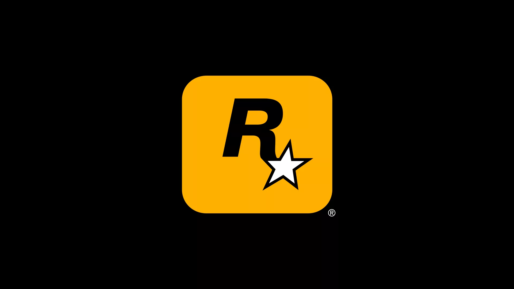

# Case Study #001 — Rockstar Games

<p align="center">
  
</p>

## II. Business Needs, Problems & Objectives

> **Project BA — 1-Year Quest to Map 100 Business Processes**

---

## 📌 Overview

This document identifies Rockstar Games' potential business needs, problems, objectives, opportunities, and desired business outcomes.

The objective is to understand what the organization needs to achieve, identify potential challenges that may prevent it from achieving its objectives, and establish opportunities for further Business Analysis.

This analysis is based on publicly available information and the business context established in the previous document.

> **Note:** Potential business problems and root causes are analytical hypotheses, not confirmed internal business issues.

---

## 1. Business Context

### Business Overview

Rockstar Games is a video game developer and publisher owned by Take-Two Interactive. It develops premium games such as Grand Theft Auto and Red Dead Redemption, generating revenue through game sales, online services, subscriptions, and in-game purchases.

### Business Context Summary

Rockstar operates in a competitive gaming industry where player expectations, technological advancements, development costs, and long-term engagement influence its success.

---

## 2. Business Needs

Business needs describe what the organization needs to achieve, improve, address, or maintain.

| # | Business Need | Why It Matters |
|---|---|---|
| 1 | Sustain Player Engagement | Maintains player communities and the long-term value of its games. |
| 2 | Deliver Successful Major Releases | Protects its reputation and generates significant revenue. |
| 3 | Strengthen Recurring Revenue | Creates revenue beyond initial game purchases. |
| 4 | Maintain Product Quality and Innovation | Differentiates Rockstar from competitors. |
| 5 | Ensure Sustainable Game Operations | Supports efficient development and reliable online services. |

### Business Needs Summary

Rockstar needs to deliver successful games, maintain long-term player engagement, generate recurring revenue, protect product quality, and sustain its gaming ecosystem.

---

## 3. Potential Business Problems

Business problems describe potential conditions that may negatively affect the organization's ability to achieve its business needs and objectives.

| # | Potential Business Problem | Potential Business Impact |
|---|---|---|
| 1 | High dependence on major game releases and franchises. | Revenue may be affected by delays or unsuccessful releases. |
| 2 | Maintaining player engagement throughout long game lifecycles. | Declining engagement may reduce recurring revenue. |
| 3 | Increasing game development complexity and costs. | May increase financial risk and development timelines. |
| 4 | Maintaining a stable and fair online gaming environment. | Cheating, disruptions, or security incidents may affect player satisfaction. |
| 5 | Managing player migration between major releases and existing games. | May affect engagement and revenue from existing online services. |

### Problem Summary

Rockstar may face challenges maintaining sustainable revenue and player engagement while managing high development costs, franchise dependence, and online gaming operations.

---

## 4. Business Objectives

Business objectives describe what the organization wants to accomplish.

| # | Business Objective | Desired Direction |
|---|---|---|
| 1 | Increase Player Engagement | Maintain active and returning players. |
| 2 | Maximize Major Game Success | Achieve strong sales and positive player reception. |
| 3 | Grow Recurring Revenue | Increase revenue from online services and in-game spending. |
| 4 | Maintain Competitive Advantage | Deliver innovative and high-quality gaming experiences. |
| 5 | Improve Operational Sustainability | Maintain efficient, reliable, and sustainable game operations. |

### Business Objectives Summary

Rockstar aims to maintain player engagement, maximize game success, grow recurring revenue, preserve its competitive advantage, and sustain efficient operations.

---

## 5. Business Opportunities

Business opportunities represent potential ways the organization could create additional value, improve performance, or achieve its objectives.

| # | Business Opportunity | Potential Value |
|---|---|---|
| 1 | Improve Player Feedback and Data Analysis | Better understand player behavior and preferences. |
| 2 | Strengthen Online Gaming Ecosystems | Increase player retention and game longevity. |
| 3 | Expand Recurring Revenue Opportunities | Generate more predictable long-term revenue. |
| 4 | Support User-Generated Content and Creators | Encourage community participation and engagement. |
| 5 | Improve Development Efficiency | Reduce inefficiencies while maintaining quality. |

### Business Opportunities Summary

Rockstar may create additional value through improved player insights, stronger online ecosystems, recurring revenue models, creator communities, and more efficient development processes.

---

## 6. Desired Business Outcomes

Business outcomes describe the results the organization hopes to achieve after addressing its business needs or implementing changes.

| # | Desired Business Outcome | Potential Measurement |
|---|---|---|
| 1 | Higher Player Retention | Player retention rate, returning players |
| 2 | Increased Recurring Revenue | In-game spending, subscription revenue |
| 3 | Successful Game Releases | Sales, revenue, player ratings |
| 4 | Improved Online Experience | Server uptime, player complaints |
| 5 | More Efficient Development | Development time, costs, milestone completion |

### Business Outcomes Summary

Successful business changes may result in stronger player engagement, sustainable revenue, successful game releases, improved online experiences, and more efficient operations.

---

## 7. Key Findings

The following findings summarize the most important areas identified during the analysis.

| Category | Finding |
|---|---|
| **Most Important Business Need** | Sustain long-term player engagement and revenue across Rockstar's gaming ecosystem. |
| **Most Important Potential Problem** | High dependence on major game releases and franchises may expose the business to revenue fluctuations. |
| **Most Important Business Objective** | Maintain player engagement while maximizing the commercial success and long-term value of its games. |
| **Most Promising Opportunity** | Improve player engagement through better understanding of player behavior, feedback, and content preferences. |
| **Potential Desired Outcome** | Maintain strong player engagement, generate sustainable revenue, and operate the gaming ecosystem efficiently. |

---

## 8. Assumptions & Limitations

### Assumptions

- Player engagement contributes to the long-term value of Rockstar's games.
- Recurring revenue is important to its business model.
- Major game releases represent significant business events.

### Limitations

- Analysis is based on publicly available information.
- Internal processes and performance data are unavailable.
- Identified problems and root causes are hypotheses, not confirmed issues.

---


---

## 9. External References

The following sources provide publicly available information used to establish the business context and support the analysis.

| # | Reference | Description | Source Link |
|---|---|---|---|
| 1 | Take-Two Interactive SEC Filing | Identifies risks involving competition, product development, release timing, franchise dependence, technology, security, and personnel. | [Securities and Exchange Commission](https://www.sec.gov/Archives/edgar/data/946581/000162828026072254/ttwo-20260930.htm?utm_source=chatgpt.com) |
| 2 | Take-Two Interactive FY2026 Annual Report | Describes Rockstar's strategy of developing a limited number of high-quality titles with long market lifecycles and incremental revenue opportunities from virtual currency, add-on content, and in-game purchases. | [Take-Two Interactive](https://ir.take2games.com/static-files/31b9a69d-016e-4d72-9d91-b911f1313bed?utm_source=chatgpt.com) |
| 3 | Take-Two Interactive FY2026 Results | Shows the importance of recurrent consumer spending, including virtual currency, add-on content, and in-game purchases, to the company's revenue. | [Take-Two Interactive Software, Inc.](https://taketwointeractivesoftwareinc.gcs-web.com/news-releases/news-release-details/take-two-interactive-software-inc-reports-results-fourth-2?utm_source=chatgpt.com) |

### Reference Notes

- Sources are used to support the publicly available business information discussed in this analysis.
- Business problems, opportunities, and findings represent analytical interpretations based on the available information.
- References do not necessarily confirm the existence of the potential internal business problems identified.


---

## 10. Conclusion

Rockstar Games needs to maintain player engagement, deliver successful major releases, generate recurring revenue, and sustain its competitive advantage.

Potential challenges include dependence on major franchises, maintaining long-term engagement, increasing development complexity, and managing online gaming operations.

Further Business Analysis is required to validate these potential problems and identify the business processes that may contribute to them.

---

## 🔍 Next Analysis Phase

The next step is to identify the people and groups involved in, affected by, or interested in Rockstar Games' business activities.

**Next: Stakeholder Analysis**

---

## 📚 Project BA

This case study is part of:

**Project BA — 1-Year Quest to Map 100 Business Processes**

The objective is to develop Business and Systems Analysis capabilities through practical analysis of business processes, problems, requirements, and potential solutions.

### Case Study Documentation

```text
project-ba/
│
├── README.md
│
└── case-studies/
    │
    └── 001-rockstar-games/
        ├── README.md
        └── I-business-context.md
        └── II-business-needs-problems-objectives.md
```

---

*Project BA — 1-Year Quest to Map 100 Business Processes.* <br>
*By: RavenKlein T. Rubin (Project Raven)*
